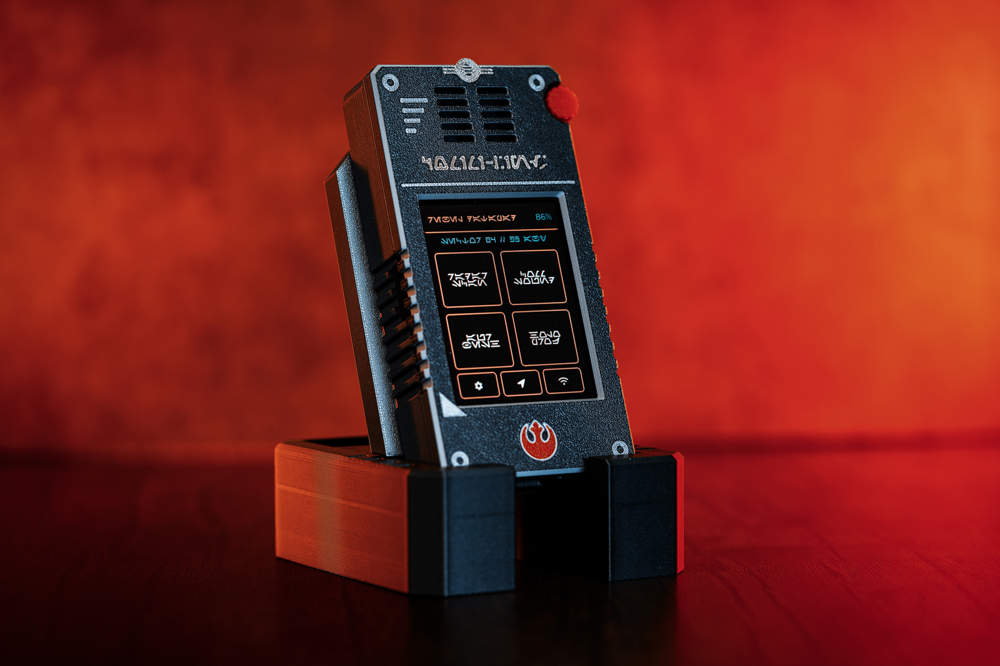

# Star Wars Pocket Datapad

[Español](README.es.md)

A pocket-sized, Star Wars-style **datapad / comlink** built around the
**ES3C28P** (ESP32-S3 with a 2.8" capacitive IPS touch display,
audio codec, amplifier, microSD slot, battery charger and USB-C): a
parametric 3D-printable enclosure plus a touch-screen firmware with a
tactical radar, a comlink soundboard, a hologram projector, an Aurebesh
keyboard and a fully switchable interface language (Spanish, English or
Aurebesh).



> **Unofficial fan project.** Star Wars and all related names and designs
> belong to Lucasfilm / Disney. Non-commercial; see
> [NOTICE.md](NOTICE.md).

## Highlights

**Firmware** (`firmware/`, LVGL 8.4 + LovyanGFX, PlatformIO)

- **Tactical radar**: holographic 3D wireframe sphere you can drag to rotate,
  with a sweeping meridian and fading trail; allied and hostile contacts fly
  inside it and light up when the beam crosses them.
- **Hologram projector**: ten live wireframe 3D models (Death Star, X-Wing,
  TIE fighter, Rebel crest, Tatooine, Coruscant, Endor, Star Destroyer, R2-D2,
  Hoth) with a holographic look (depth-faded lines, flicker, glitches,
  scanlines, projector base). Drag to rotate, flick to switch model.
- **Comlink soundboard** and UI sounds played through the built-in speaker by
  a non-blocking PCM engine (ES8311 codec + FM8002E amplifier). Sounds are WAV
  files loaded from the microSD card, the internal LittleFS partition, or
  built-in synthesized fallbacks.
- **Aurebesh keyboard**: tap letters to see the glyph, its name and compose
  text.
- **Star chart**: a stylized spiral galaxy with twelve tappable systems;
  planets that have a wireframe model jump straight to the hologram
  projector.
- **Signal beacon**: sends the keyboard's message (or "SOS") in morse code
  over the RGB LED plus an optional full-screen strobe.
- **Languages**: Spanish, English and **Aurebesh** (English text drawn with
  the Aurebesh font), switchable from Settings.
- **Color themes**: Tatooine (default, amber and turquoise) and Imperial
  (red and steel grey), switchable from Settings.
- **P2P link (ESP-NOW)**: two datapads can detect each other over a radio
  beacon, toggled from the Comlink screen.
- **Gestures, battery monitor and power saving**: rightward swipe goes back
  to Home, the top bar shows the real battery charge, the display sleeps
  after 3 min without touch and the board enters deep sleep after 60 min
  (a touch on the screen wakes it).
- Splash screen, screen transitions and persistent settings (brightness,
  volume, language, theme).

**Enclosure** (`3DPrints/`, `docs/`)

- Two-part case (front bezel and rear chassis), 61 x 120 x 22 mm, printable
  with no supports, with openings for USB-C, the microSD slot, the BOOT
  button and a speaker bay sized for the stock speaker or an optional
  20 mm upgrade (adapter plate included).
- Multicolor-ready Rebel crest and border inlays on the front bezel.
- A matching two-piece desktop stand: tool-free tenon/mortise assembly,
  70° viewing angle and a continuous USB-C charging channel.
- Manufacturing-ready engineering drawings (ISO-style blueprint sheets) in
  `docs/blueprints/` ([docs/enclosure.md](docs/enclosure.md)).

## What you need

- **ES3C28P** — an all-in-one ESP32-S3 board: 2.8" 240x320 ILI9341V
  IPS display (SPI), FT6336G capacitive touch, ES8311 audio codec, FM8002E
  amplifier with speaker, WS2812 RGB LED, microSD slot (SDIO), TP4054
  Li-Ion charger, battery ADC and USB-C. No wiring required.
- A 3.7 V Li-Ion/LiPo battery with a JST PH 2.0 connector (the board
  charges it over USB-C; the datapad also runs on USB power alone).
- A microSD card (optional, for custom sound effects).
- The 3D-printed enclosure: the ready-to-slice project is
  [`3DPrints/datapad/ES3C28P_StarWars_Datapad.3mf`](3DPrints/datapad/ES3C28P_StarWars_Datapad.3mf)
  (three plates: front bezel, rear chassis, optional speaker mount).

## Quick start

```bash
cd firmware
pio run -e esp32-s3-es3c28p -t upload --upload-port /dev/cu.usbmodemXXXX
```

Always pass `--upload-port` explicitly. See
[`firmware/README.md`](firmware/README.md) for the full build guide, the
sound-clip setup (`uploadfs` / microSD) and serial diagnostics.

## Web simulator

The datapad's real UI code also compiles to WebAssembly, so you can try it
in a browser — same screens, sounds and P2P link (between two tabs):

- **Live demo**: <https://ainxstep.github.io/star-wars-pocket-datapad/>
- Build it locally with `simulator/build.sh` and serve it with
  `simulator/serve.sh` (needs Emscripten; see
  [`simulator/README.md`](simulator/README.md)).

## Repository layout

```
firmware/          PlatformIO project (env: esp32-s3-es3c28p)
  src/             UI, screens, audio engine, ESP-NOW link, board layer
  include/         board.h abstraction, LVGL config, generated assets
  sounds/          Sample sound effects (WAV)
  tools/           Asset generators (logo, crest, fonts, sounds)
simulator/         WebAssembly build of the real firmware UI (Emscripten)
  web/             The deployable page (index.html, sim.js, datapad.wasm)
3DPrints/
  datapad/         Enclosure: 3MF project, STLs, STEPs, assembly
  stand/           Desktop stand: STLs and STEPs
docs/
  enclosure.md     Enclosure dimensions, tolerances, assembly
  blueprints/      Engineering drawings (4 sheets, PDF + PNG)
  images/          Photos and renders
.github/workflows/ GitHub Pages deploy (builds the simulator in CI)
```

## Licenses

- **Firmware and simulator code** (`firmware/`, `simulator/`): MIT —
  [LICENSE](LICENSE).
- **3D models, drawings and enclosure files** (`3DPrints/`,
  `docs/blueprints/`, `docs/images/`): CC BY-NC-SA 4.0 —
  [LICENSE-HARDWARE.md](LICENSE-HARDWARE.md).
- Credits, fonts and trademark notes: [NOTICE.md](NOTICE.md).
