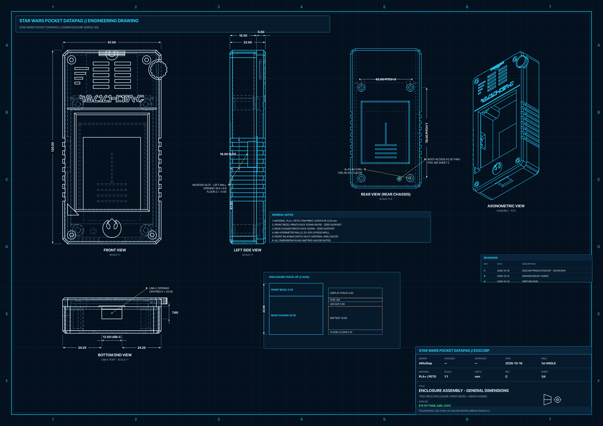
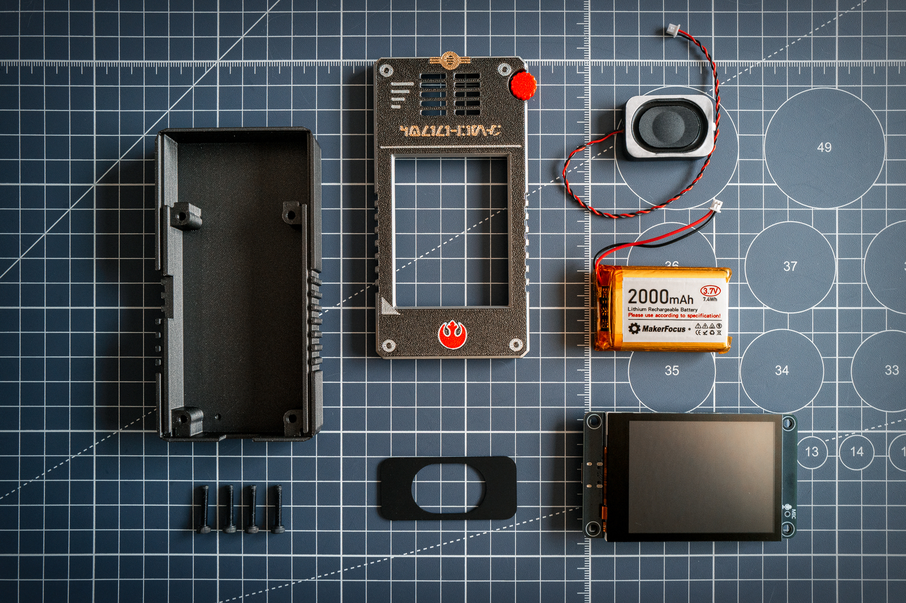

# Carcasa del Datapad ES3C28P (especificaciones y guía de impresión)

> [English version](enclosure.md) · [Volver al README](../README.es.md)

Diseño paramétrico en 3D desarrollado en **FreeCAD 1.1** para transformar el módulo táctil capacitivo **ES3C28P (ESP32-S3 con pantalla IPS de 2.8" y conector USB-C)** en un intercomunicador Datapad táctico de Star Wars (estética de la Alianza Rebelde / equipo de campo Imperial).

El diseño incluye tolerancia cero para soportes en la cara frontal (True Zero-Support FDM sobre lámina PEI), compensación métrica calibrada para el apilamiento de pantalla capacitiva de $4.30\text{ mm}$, cámara superior ampliada para el altavoz, acceso directo al botón BOOT, montura adaptadora para reemplazo de altavoz, y una Base Exhibidora de Escritorio a juego. El bisel frontal y la montura de altavoz no requieren soportes; el chasis trasero también está diseñado para imprimirse sin ellos, aunque el `.3mf` incluido los habilita para un mejor acabado.

---

## 📐 Especificaciones y Cotas Calibradas

| Parámetro | Medida | Descripción y Restricciones Físicas |
| :--- | :--- | :--- |
| **Dimensiones exteriores** | **61.0 x 120.0 x 22.0 mm** | Bisel frontal 5.5 mm + Chasis trasero 16.5 mm. Alberga el PCB de $50.0 \times 86.0\text{ mm}$ y cámara acústica superior. |
| **Grosor Display Stack** | **4.30 mm** | Cristal táctil CTP 1.0 mm + OCA 0.5 mm + LCD IPS 2.3 mm + adhesivo 0.5 mm (plano del módulo `CR2025-MI6140`, publicado en LCDWIKI). |
| **Prolongación de torres frontales** | **Z = -0.80 mm** (altura 4.80 mm) | Las 4 torres del bisel frontal descienden hasta $Z = -0.80\text{ mm}$ para hacer contacto rígido contra la cara frontal del PCB. **Elimina 100% el desplazamiento o juego del PCB al conectar/desconectar el cable USB-C**. |
| **Orificios piloto frontales** | $\varnothing 2.85\text{ mm}$ con embudo | Embudo cónico de autocentrado ($\varnothing 3.40 \to 2.85\text{ mm}$) en los primeros $0.8\text{ mm}$ seguido de orificio cilíndrico de $\varnothing 2.85\text{ mm}$ (profundidad de rosca 4.5 mm) para tornillos M3 autorroscantes. |
| **Paso de torres de tornillos** | **Paso 78.0 x 42.0 mm** | Torres superiores ($Y = 81.0\text{ mm}$), inferiores ($Y = 3.0\text{ mm}$). Centros en $X = \pm 21.0\text{ mm}$ respecto al centro de placa ($X = 25.0\text{ mm}$). |
| **Ventana activa de display** | 59.8 x 46.8 mm | Enmarcada al milímetro para centrar el área iluminada del panel IPS sin tapar píxeles útiles ni mostrar bordes inactivos. |
| **Chasis trasero (profundidad)** | 16.5 mm exterior (14.7 mm neta) | Proporciona $14.7\text{ mm}$ libres ($Z \in [-14.7, 0.0]\text{ mm}$) para alojar batería LiPo, cables y componentes sin someter la placa a compresión. |
| **Cámara superior de altavoz** | **54.8 mm ancho continuo** | Compartimento diáfano a profundidad total ($Z = -14.7\text{ mm}$) entre $Y \in [86.0, 113.7]\text{ mm}$. Sin muros transversales ni escalones intermedios. |
| **Montura de altavoz alternativa** | **54.5 x 25.5 x 1.0 mm** | Placa adaptadora (`ES3C28P_StarWars_Speaker_Mount.step/.stl`) con abertura estadio de $30.0 \times 20.0\text{ mm}$ ($R = 10.0\text{ mm}$) y holgura de $0.15\text{ mm}$ por cara para montar un altavoz rectangular genérico de repuesto (el cable del altavoz original resulta demasiado corto para esta carcasa). |
| **Batería LiPo** | Hasta 50.0 x 34.0 x 10.0 mm (recomendada: 2000–3000 mAh) | Ubicada en el fondo del chasis trasero ($Z = -14.4\text{ mm}$) con margen de aire holgado sobre los componentes del PCB. Una de mayor capacidad excede la bahía; una de menor se agota demasiado rápido. |
| **Tornillería** | 4x M3 x 17 mm | Orificios pasantes $\varnothing 3.4\text{ mm}$ con avellanado cilíndrico $\varnothing 6.2\text{ mm}$ (profundidad 3.2 mm) en el chasis trasero. |

*Todo lo que lleva el build: chasis trasero, bisel frontal multicolor, placa speaker mount, placa ES3C28P, LiPo de 2000 mAh, altavoz rectangular de repuesto y 4 tornillos M3 x 17 mm.*

---

## 📐 Planos de Ingeniería (Blueprints)

Un juego de cuatro láminas de plano técnico estilo ISO (proyección en
primer diedro, líneas ocultas, cortes de sección reales, acotación y
cajetines) está disponible en `docs/blueprints/` en PDF y PNG:

| Lámina | Nº de plano | Contenido |
| :--- | :--- | :--- |
| [`es3c28p_blueprint_sheet1_assembly.pdf`](blueprints/es3c28p_blueprint_sheet1_assembly.pdf) | ES3C28P-ME-001 | Ensamble: vistas frontal, lateral, trasera y axonométrica, vista de extremo USB-C, apilado en Z |
| [`es3c28p_blueprint_sheet2_front_bezel.pdf`](blueprints/es3c28p_blueprint_sheet2_front_bezel.pdf) | ES3C28P-ME-002 | Bisel frontal: caras exterior e interior más sección A-A por las torres de tornillos |
| [`es3c28p_blueprint_sheet3_rear_chassis.pdf`](blueprints/es3c28p_blueprint_sheet3_rear_chassis.pdf) | ES3C28P-ME-003 | Chasis trasero: vista interior, sección A-A, lateral MicroSD, vista de extremo USB-C |
| [`es3c28p_blueprint_sheet4_speaker_mount.pdf`](blueprints/es3c28p_blueprint_sheet4_speaker_mount.pdf) | ES3C28P-ME-004 | Placa adaptadora de altavoz, vista superior 2:1 y espesor |

---

## 🔌 Accesibilidad de Puertos y Controles

* **Borde Inferior (Puerto USB-C Centrado):**
  * Conector USB-C centrado en $X = 25.0\text{ mm}$ ($X \in [18.5, 31.5]\text{ mm}$, $Z \in [-7.55, 0.05]\text{ mm}$).
  * Cuenta con un **rebaje escalonado de 2.0 mm adicional hacia la cara trasera** para garantizar holgura total del cuerpo de cualquier cable USB-C estándar o conector en ángulo de 90°.
* **Lateral Izquierdo (MicroSD Push-Push):**
  * Ranura calibrada de **$16.0\text{ mm}$** ($Y \in [29.5, 45.5]\text{ mm}$, piso a $Z = -5.5\text{ mm}$) con labio perimetral recortado al ras.
  * Muesca ergonómica semicircular de **$5.5\text{ mm}$ de radio** para inserción y extracción cómoda con la uña.
* **Lateral Izquierdo (Orificio botón BOOT):**
  * Orificio cilíndrico de **$\varnothing 2.0\text{ mm}$ en $X = 0.0\text{ mm}, Y = 18.0\text{ mm}$** alineado exactamente con el pulsador BOOT de la placa ES3C28P.
  * Permite ingresar a modo de descarga manual de firmware mediante un clip o pin sin necesidad de abrir la carcasa.

---

## 🎨 Greeblies y Acabado Táctico Sci-Fi / Star Wars

1. **Rótulo militar `COMM-LINK` en Aurebesh:** Tipografía Aurebesh auténtica vectorial de `banner.svg` ($39.5 \times 4.2\text{ mm}$, centrado en $X = 25.0\text{ mm}, Y = 84.5\text{ mm}$), coplanar a $Z = 5.5000\text{ mm}$ con profundidad de 0.60 mm en filamento blanco.
2. **Insignia Rebelde Tricolor Embebida:** Emblema vectorial paramétrico con núcleo rojo y **ribete blanco estilizado de $0.50\text{ mm}$**, ambos coplanares a $Z = 5.5000\text{ mm}$ con profundidad de 0.60 mm (exactamente 3 capas a 0.20 mm).
3. **True Zero-Support FDM (Cama PEI Texturizada):** El 100% de la cara frontal exterior y todos sus adornos (rótulo Aurebesh, insignia, barritas de señal, pernos hexagonales de esquinas y dial de sintonía) están rigurosamente enrasados a $Z = 5.5000\text{ mm}$. Al imprimirse boca abajo, hacen contacto directo con la cama en la Capa 1, transfiriendo una textura mate táctica impecable sin necesidad de soportes ni riesgo de hilos colgantes.
4. **Rejilla acústica Comlink reforzada:** Corte pasante limpio con nervio central macizo para máxima resonancia del altavoz sin vibraciones parásitas.
5. **Disipadores térmicos traseros:** Canales de ventilación estilizados centrados simétricamente a $Y = 42.0\text{ mm}$ entre los 4 tornillos M3.

---

## 🔊 Montura Adaptadora de Altavoz (`Speaker_Mount`)

La placa ES3C28P incluye de fábrica un altavoz **rectangular** de buena calidad, pero su cable de conexión es demasiado corto para tenderlo cómodamente dentro de esta carcasa. Para esa situación se incluye la pieza adaptadora [`ES3C28P_StarWars_Speaker_Mount`](../3DPrints/datapad/ES3C28P_StarWars_Speaker_Mount.stl), que permite montar un **altavoz rectangular genérico de repuesto** (el tipo común que se vende en AliExpress y tiendas similares). Si puedes alargar o reencaminar el cable del altavoz original, el adaptador no es necesario:

- **Medidas:** $54.50 \times 25.50 \times 1.00\text{ mm}$ con esquinas $R = 5.0\text{ mm}$.
- **Abertura:** Ventana oblonga tipo estadio de $30.0 \times 20.0\text{ mm}$ ($R = 10.0\text{ mm}$ en extremos).
- **Montaje:** Asienta directamente en el fondo de la cámara superior ensanchada ($54.8\text{ mm}$) del `Rear_Chassis`, ofreciendo un soporte perimetral estable para sellar la cámara acústica con cinta de doble cara o adhesivo B-7000.

---

## 🖥️ Base Exhibidora de Escritorio

El datapad se acopla a una base exhibidora modular a juego — ensamble de dos piezas por espiga y mortaja, sin herramientas ([`Stand_Base`](../3DPrints/stand/StarWars_Stand_Base.stl) + [`Stand_Cradle`](../3DPrints/stand/StarWars_Stand_Cradle.stl)):

- **Bahía de exhibición:** La bahía inclinada a $70.0^\circ$ sostiene el datapad en un ángulo de visualización cómodo.
- **Canal pasante de carga USB-C:** Un canal abierto alineado con el puerto USB-C centrado permite cargar el datapad mientras está en la base, con cables rectos o en ángulo de 90°.

---

## 🖨️ Guía de Laminación e Impresión 3D

El proyecto integral preconfigurado para Bambu Studio / OrcaSlicer se encuentra listo para usar en:
[`3DPrints/datapad/ES3C28P_StarWars_Datapad.3mf`](../3DPrints/datapad/ES3C28P_StarWars_Datapad.3mf)

### Organización de Placas en el archivo `.3mf`:
* **Placa 1 — Front Bezel (Multicolor AMS):**
  * Cara frontal apoyada sobre la lámina PEI texturizada.
  * **Cero soportes.**
  * Altura de capa recomendada: **$0.16\text{ mm}$** (o $0.20\text{ mm}$ con primera capa a $0.20\text{ mm}$).
  * Las primeras 3 capas realizan los cambios de filamento para los inlays de color; a partir de $Z > 0.60\text{ mm}$ continúa a mono-color a máxima velocidad sin torre de purga activa.
* **Placa 2 — Rear Chassis:**
  * Cara posterior plana apoyada sobre la cama PEI.
  * **Soportes habilitados en el `.3mf`** — no son estrictamente necesarios
    (la pieza está diseñada para imprimirse sin ellos), pero el proyecto
    exportado los mantiene activos porque mejoran la calidad superficial
    alrededor de los avellanados y los bordes de la cavidad. Desactívalos
    en el laminador si prefieres omitirlos.
  * Altura de capa: $0.16\text{ mm}$ o $0.20\text{ mm}$.
* **Placa 3 — Speaker Mount:**
  * Pieza plana de $1.0\text{ mm}$ ($5$ capas a $0.20\text{ mm}$).
  * **Cero soportes.**

### Trabajo de Impresión de Referencia (como en la foto de portada)

Impreso en una Bambu Lab H2C (doble nozzle + AMS, nozzle de $0.4\text{ mm}$, capas de $0.16\text{ mm}$, PEI texturizada). Los tiempos son las estimaciones del laminador para esa impresora — espera variaciones en otras máquinas:

| Placa | Pieza | Filamento | Usado | Tiempo est. |
|-------|-------|-----------|-------|-------------|
| 1 | Front Bezel | Bambu PLA Basic Gris Plata `#A6A9AA` (cuerpo) + PLA Metal Grafito `#43403D` + inlays PLA Basic Blanco `#FFFFFF`, Rojo `#C12E1F` y PLA Metal Arena `#B39B84` | ~24 g | ~2 h 11 min |
| 2 | Rear Chassis | Bambu PLA Metal Grafito `#43403D` + interfaz de soporte PLA | ~34 g | ~1 h 50 min |
| 3 | Speaker Mount | Bambu PLA Basic Negro `#000000` | ~1 g | ~11 min |

Un bisel monocolor también imprime perfectamente — simplemente asigna todos los objetos de la placa 1 a un solo filamento.

### Parámetros recomendados:
* **Material:** PLA (Bambu PLA Basic / Matte / Metal / Galaxy) o PETG.
* **Paredes / Perímetros:** 3 a 4 perímetros continuos (garantiza rigidez estructural en las torres de tornillo).
* **Relleno:** 15% giroide.
* **⚠️ Aviso de apriete:** Atornillar los 4 tornillos M3 con suavidad hasta hacer tope firme. Gracias a la prolongación de torres frontales a $Z = -0.80\text{ mm}$, el PCB queda firmemente bloqueado sin necesidad de sobreapretar ni someter el cristal táctil a flexión.

---

## 📁 Catálogo de Archivos en `3DPrints/datapad/`

| Archivo | Tipo | Descripción |
| :--- | :--- | :--- |
| [`ES3C28P_StarWars_Datapad.3mf`](../3DPrints/datapad/ES3C28P_StarWars_Datapad.3mf) | Bambu Studio 3MF | Proyecto completo preconfigurado en 3 placas (Frontal, Trasero, Montura Speaker) |
| [`ES3C28P_StarWars_Front_Bezel.step`](../3DPrints/datapad/ES3C28P_StarWars_Front_Bezel.step) | STEP | Bisel frontal con torres extendidas a $Z = -0.80\text{ mm}$ (True Zero-Support) |
| [`ES3C28P_StarWars_Front_Bezel_Multicolor.step`](../3DPrints/datapad/ES3C28P_StarWars_Front_Bezel_Multicolor.step) | STEP multicolor | Ensamble frontal con sólidos separados para fácil asignación de color en slicers |
| [`ES3C28P_StarWars_Rear_Chassis.stl`](../3DPrints/datapad/ES3C28P_StarWars_Rear_Chassis.stl) / [`.step`](../3DPrints/datapad/ES3C28P_StarWars_Rear_Chassis.step) | STL / STEP | Chasis trasero con cámara superior ensanchada ($54.8\text{ mm}$) |
| [`ES3C28P_StarWars_Speaker_Mount.stl`](../3DPrints/datapad/ES3C28P_StarWars_Speaker_Mount.stl) / [`.step`](../3DPrints/datapad/ES3C28P_StarWars_Speaker_Mount.step) | STL / STEP | Placa montura adaptadora para sustitución de altavoz |
| [`ES3C28P_StarWars_Pocket_Datapad_Assembly.step`](../3DPrints/datapad/ES3C28P_StarWars_Pocket_Datapad_Assembly.step) | STEP de ensamble | Ensamble CAD completo con mockups de componentes |
| `es3c28p_blueprint_sheet*.pdf/.png` en `docs/blueprints/` | PDF / PNG | Juego de cuatro láminas de plano técnico (ES3C28P-ME-001 … -004) |

Los STL de alta resolución de los cuerpos multicolor del bisel frontal
(`ES3C28P_StarWars_Front_Bezel.stl`, `Front_Accents`, `Front_Rebel_Crest`,
`Front_Rebel_Border`, `Front_White_Inlays`) se publican como assets del
GitHub Release en lugar de en el repositorio — el proyecto `.3mf` ya los
empaqueta para imprimir.

El diseño físico está licenciado bajo [CC BY-NC-SA 4.0](../LICENSE-HARDWARE.md).
