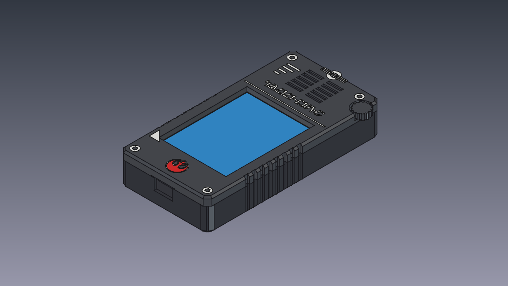
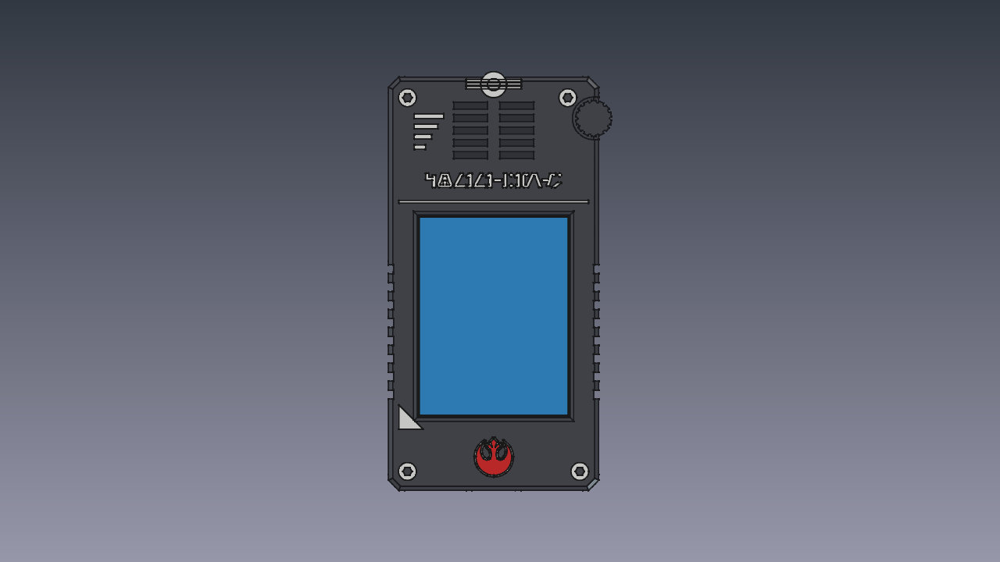
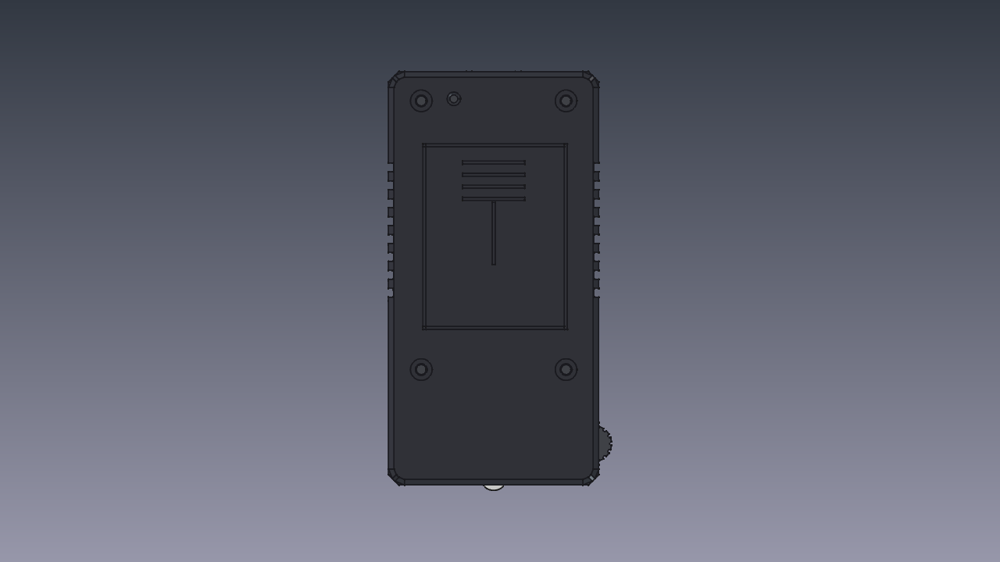
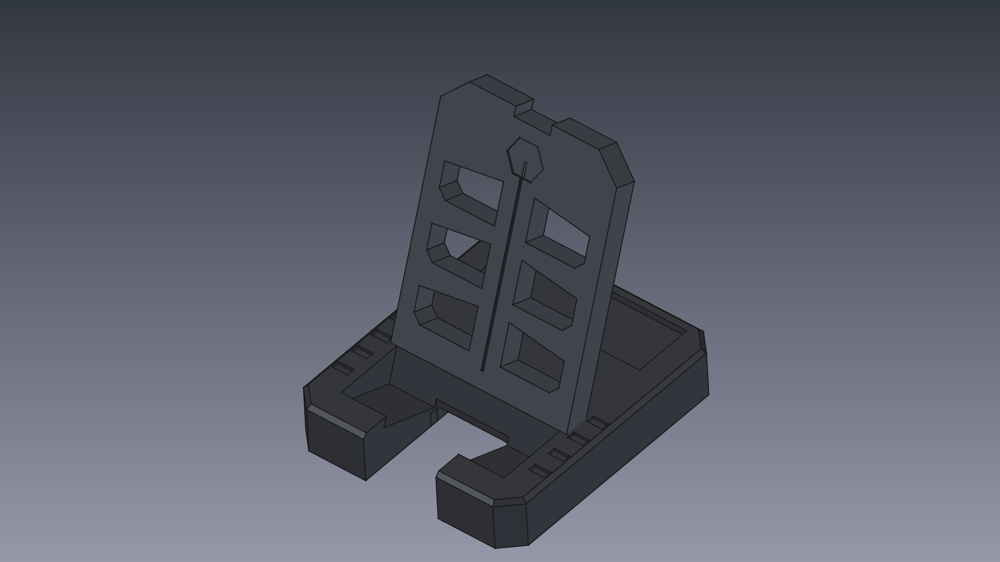
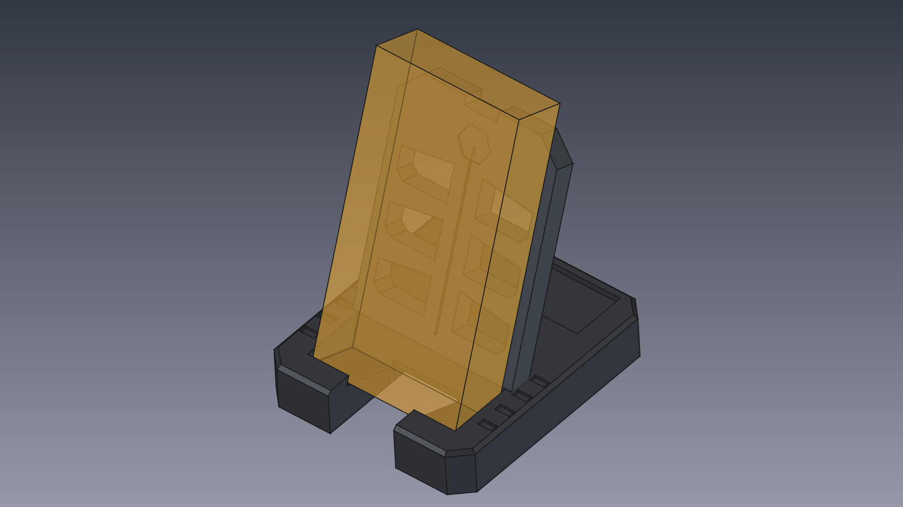
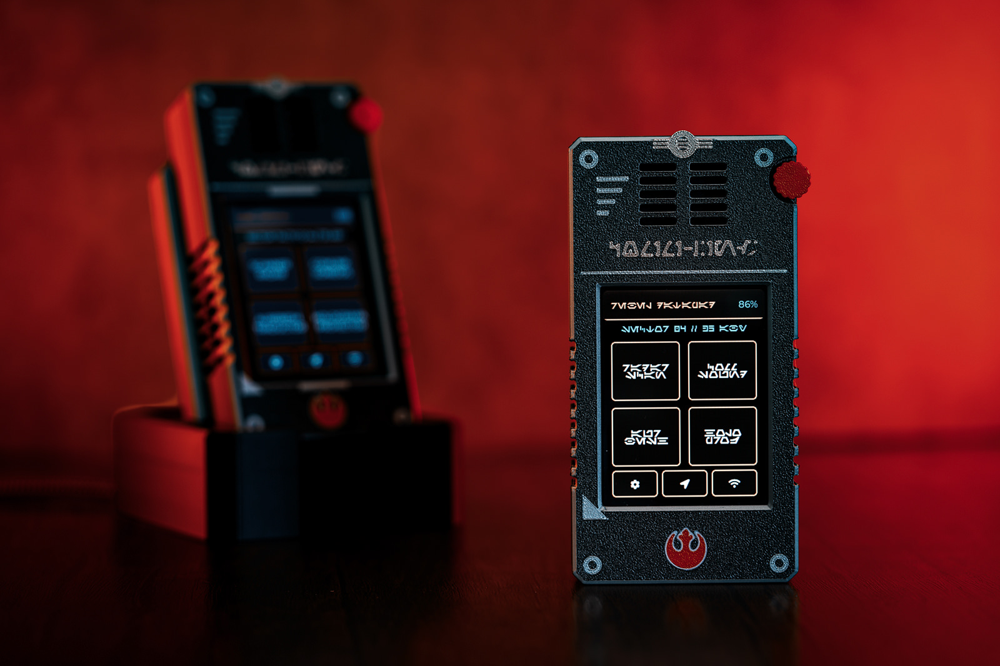

# ES3C28P Datapad Enclosure (Specifications & 3D Printing Guide)

> [Versión en español](enclosure.es.md) · [Back to README](../README.md)

Parametric 3D enclosure designed in **FreeCAD 1.1** to transform the **ES3C28P (ESP32-S3 with 2.8" Capacitive IPS display and USB-C)** module into a Star Wars tactical Datapad / comlink (Rebel Alliance / Imperial field communicator aesthetic).

The design features True Zero-Support FDM printing on the front face (textured PEI sheets), calibrated boss extensions compensating for the $4.30\text{ mm}$ capacitive display stack, an expanded continuous upper speaker cavity, direct access to the BOOT button, an optional speaker replacement adapter plate, and a matching desktop display stand. The front bezel and speaker mount need no supports; the rear chassis is designed to print support-free as well, though the bundled `.3mf` enables them for a cleaner finish.

| | | |
|:---:|:---:|:---:|
|  |  |  |
| *Assembly — isometric* | *Assembly — front* | *Assembly — rear* |

---

## 📐 Specifications & Calibrated Dimensions

| Parameter | Measurement | Description & Physical Constraints |
| :--- | :--- | :--- |
| **External Dimensions** | **61.0 x 120.0 x 22.0 mm** | Front Bezel 5.5 mm + Rear Chassis 16.5 mm. Houses the $50.0 \times 86.0\text{ mm}$ PCB and upper acoustic chamber. |
| **Display Stack Thickness** | **4.30 mm** | CTP glass 1.0 mm + OCA 0.5 mm + IPS LCD 2.3 mm + adhesive 0.5 mm (display module drawing `CR2025-MI6140`, published on LCDWIKI). |
| **Front Screw Boss Extension** | **Z = -0.80 mm** (total height 4.80 mm) | The 4 front bezel screw bosses extend down to $Z = -0.80\text{ mm}$ to make direct rigid contact against the front face of the PCB. **Eliminates 100% of PCB axial sliding/play during USB-C cable insertion and extraction**. |
| **Front Pilot Holes** | $\varnothing 2.85\text{ mm}$ with lead-in funnel | Self-centering conical funnel ($\varnothing 3.40 \to 2.85\text{ mm}$) across the first $0.8\text{ mm}$, followed by $\varnothing 2.85\text{ mm}$ blind pilot hole (4.5 mm thread depth) for tight M3 thread engagement. |
| **Screw Tower Pitch** | **78.0 x 42.0 mm Matrix** | Upper towers ($Y = 81.0\text{ mm}$), lower towers ($Y = 3.0\text{ mm}$). Tower centers at $X = \pm 21.0\text{ mm}$ relative to PCB center ($X = 25.0\text{ mm}$). |
| **Active Display Window** | 59.8 x 46.8 mm | Millimeter-accurate framing centered on the active illuminated IPS area without clipping usable pixels or exposing inactive borders. |
| **Rear Chassis (Net Depth)** | 16.5 mm outer (14.7 mm net) | Provides $14.7\text{ mm}$ net clearance ($Z \in [-14.7, 0.0]\text{ mm}$) to accommodate LiPo battery, wires, and components without pressure on the board. |
| **Upper Speaker Chamber** | **54.8 mm continuous width** | Completely open cavity at full depth ($Z = -14.7\text{ mm}$) across $Y \in [86.0, 113.7]\text{ mm}$. Transverse walls and stepped shelves removed. |
| **Speaker Mount Adapter** | **54.5 x 25.5 x 1.0 mm** | Adapter plate (`ES3C28P_StarWars_Speaker_Mount.step/.stl`) with $30.0 \times 20.0\text{ mm}$ stadium cutout ($R = 10.0\text{ mm}$) and $0.15\text{ mm}$ per-side clearance to mount a generic rectangular replacement speaker (the stock unit's cable is too short for this case). |
| **LiPo Battery** | Up to 50.0 x 34.0 x 10.0 mm (2000–3000 mAh recommended) | Located at the floor of the rear chassis ($Z = -14.4\text{ mm}$) with ample air clearance above PCB surface components. Higher-capacity packs exceed the bay; smaller ones drain too fast. |
| **Fasteners** | 4x M3 x 17 mm | $\varnothing 3.4\text{ mm}$ through-holes with $\varnothing 6.2\text{ mm}$ counterbores (3.2 mm depth) on the rear chassis. |

---

## 📐 Engineering Blueprints

A four-sheet ISO-style engineering drawing set (first-angle projection,
hidden lines, real section cuts, dimensions and title blocks) is available
in `docs/blueprints/` as PDF and PNG:

| Sheet | Drawing no. | Contents |
| :--- | :--- | :--- |
| [`es3c28p_blueprint_sheet1_assembly.pdf`](blueprints/es3c28p_blueprint_sheet1_assembly.pdf) | ES3C28P-ME-001 | Assembly: front, side, rear and axonometric views, USB-C end view, stack-up |
| [`es3c28p_blueprint_sheet2_front_bezel.pdf`](blueprints/es3c28p_blueprint_sheet2_front_bezel.pdf) | ES3C28P-ME-002 | Front bezel: outer and inner faces plus an A-A section through the screw bosses |
| [`es3c28p_blueprint_sheet3_rear_chassis.pdf`](blueprints/es3c28p_blueprint_sheet3_rear_chassis.pdf) | ES3C28P-ME-003 | Rear chassis: interior view, A-A section, MicroSD side, USB-C end view |
| [`es3c28p_blueprint_sheet4_speaker_mount.pdf`](blueprints/es3c28p_blueprint_sheet4_speaker_mount.pdf) | ES3C28P-ME-004 | Speaker mount adapter plate, top view 2:1 and thickness |

---

## 🔌 Port Accessibility & Controls

* **Bottom Edge (Centered USB-C Port):**
  * USB-C port centered at $X = 25.0\text{ mm}$ ($X \in [18.5, 31.5]\text{ mm}$, $Z \in [-7.55, 0.05]\text{ mm}$).
  * Features a **2.0 mm rearward step relief** to provide full clearance for standard USB-C cable overmolds and 90-degree charging adapters.
* **Left Profile (MicroSD Push-Push Slot):**
  * Calibrated **$16.0\text{ mm}$** opening ($Y \in [29.5, 45.5]\text{ mm}$, floor at $Z = -5.5\text{ mm}$) with flush-trimmed mating lip.
  * Ergonomic semicircular thumb notch with **$5.5\text{ mm}$ radius** for effortless card insertion and extraction.
* **Left Profile (BOOT Button Pinhole):**
  * Cylindrical pinhole of **$\varnothing 2.0\text{ mm}$ at $X = 0.0\text{ mm}, Y = 18.0\text{ mm}$** directly aligned with the board's tactile BOOT switch.
  * Allows toggling firmware download mode via paperclip without dismantling the enclosure.

---

## 🎨 Star Wars Greeblies & True Zero-Support Details

1. **Military Tactical `COMM-LINK` Aurebesh Banner:** Authentic vector typography from `banner.svg` ($39.5 \times 4.2\text{ mm}$, centered at $X = 25.0\text{ mm}, Y = 84.5\text{ mm}$), coplanar with $Z = 5.5000\text{ mm}$ with 0.60 mm white filament depth.
2. **Embedded Tri-Color Rebel Crest:** Vector parametric insignia featuring a red core and **stylized $0.50\text{ mm}$ white perimeter border**, both coplanar with $Z = 5.5000\text{ mm}$ with 0.60 mm inlay depth (exactly 3 layers at 0.20 mm).
3. **True Zero-Support FDM (Textured PEI Bed):** 100% of the exterior front face and all decorative inlays (Aurebesh text, Rebel crest, signal strength bars, corner armor pads with hex bolts, and tuning dial) are coplanar at $Z = 5.5000\text{ mm}$. Printed face-down, they achieve full first-layer bed contact, transferring an immaculate textured matte finish without supports or sagging bridges.
4. **Reinforced Comlink Acoustic Grille:** Dual-column through-cut slots with a 3.6 mm solid central rib, ensuring crisp audio resonance without structural flex.
5. **Rear Heatsink Louvers:** Industrial heat dissipation fins centered symmetrically at $Y = 42.0\text{ mm}$ between the 4 screw towers.

---

## 🔊 Speaker Adapter Plate (`Speaker_Mount`)

The ES3C28P ships with a good-quality **rectangular** speaker, but its connecting cable is too short to route comfortably inside this case. For that situation the [`ES3C28P_StarWars_Speaker_Mount`](../3DPrints/datapad/ES3C28P_StarWars_Speaker_Mount.stl) adapter plate is included — it mounts a common **rectangular replacement speaker** (the generic type widely sold on AliExpress and similar stores). If you can extend or reroute the stock speaker's cable, the adapter is not needed:

- **Dimensions:** $54.50 \times 25.50 \times 1.00\text{ mm}$ with $R = 5.0\text{ mm}$ rounded corners.
- **Cutout:** Oblong stadium window measuring $30.0 \times 20.0\text{ mm}$ ($R = 10.0\text{ mm}$ ends).
- **Installation:** Drops directly into the expanded $54.8\text{ mm}$ upper cavity of the `Rear_Chassis`, providing a stable perimeter flange to seal the speaker using double-sided foam tape or B-7000 adhesive.
- **Alternate variant:** [`ES3C28P_StarWars_Speaker_Mount_b`](../3DPrints/datapad/ES3C28P_StarWars_Speaker_Mount_b.stl) — a thicker $54.0 \times 27.3 \times 3.0\text{ mm}$ plate with a stepped recess, for a different replacement speaker form factor. The `.3mf` carries both variants on plate 3; print only the one your speaker needs.

---

## 🖥️ Desktop Display Stand

The datapad docks with a matching modular display stand — a two-piece, tool-free tenon/mortise assembly ([`Stand_Base`](../3DPrints/stand/StarWars_Stand_Base.stl) + [`Stand_Cradle`](../3DPrints/stand/StarWars_Stand_Cradle.stl)):

- **Display Bay:** The $70.0^\circ$ inclined bay holds the datapad at a comfortable viewing angle.
- **Continuous USB-C Charging Channel:** An open tunnel aligned with the centered USB-C port lets the datapad charge while docked, with straight or right-angle cables.

| | | |
|:---:|:---:|:---:|
|  |  |  |
| *Two-piece stand* | *Datapad docked* | *Real build, docked* |

---

## 🖨️ 3D Printing & Slicing Guide

A pre-configured Bambu Studio / OrcaSlicer project is provided ready to slice:
[`3DPrints/datapad/ES3C28P_StarWars_Datapad.3mf`](../3DPrints/datapad/ES3C28P_StarWars_Datapad.3mf)

### Plate Layout in the `.3mf` file:
* **Plate 1 — Front Bezel (AMS Multi-Color):**
  * Front face resting flat on the textured PEI sheet.
  * **Zero supports.**
  * Recommended layer height: **$0.16\text{ mm}$** (or $0.20\text{ mm}$ with first layer at $0.20\text{ mm}$).
  * Filament swaps occur only during the first 3 layers (0.60 mm) for the colored inlays; $Z > 0.60\text{ mm}$ prints at standard speed with no ongoing purge waste.
* **Plate 2 — Rear Chassis:**
  * Flat back face resting on the PEI bed.
  * **Supports enabled in the `.3mf`** — they are not strictly required
    (the part is designed to print without them), but the shipped project
    keeps them on because they improve surface quality around the
    counterbores and cavity edges. Disable them in the slicer if you
    prefer to skip them.
  * Layer height: $0.16\text{ mm}$ or $0.20\text{ mm}$.
* **Plate 3 — Speaker Mounts:**
  * Both adapter variants ship on the plate: the flat $1.0\text{ mm}$ `Speaker_Mount` and the $3.0\text{ mm}$ `Speaker_Mount_b`. **Keep only the one your speaker needs** and delete the other before slicing — or print both if you are still deciding.
  * **Zero supports.**

### Reference Print Job (as shown in the cover photo)

Printed on a Bambu Lab H2C (dual-nozzle + AMS, $0.4\text{ mm}$ nozzle, $0.16\text{ mm}$ layers, textured PEI). Times are the slicer estimates for that printer — expect them to vary on other machines:

| Plate | Part | Filament | Used | Est. Time |
|-------|------|----------|------|-----------|
| 1 | Front Bezel | Bambu PLA Basic Silver Gray `#A6A9AA` (body) + PLA Metal Graphite `#43403D` + PLA Basic White `#FFFFFF`, Red `#C12E1F` and PLA Metal Sand `#B39B84` inlays | ~24 g | ~2 h 11 m |
| 2 | Rear Chassis | Bambu PLA Metal Graphite `#43403D` + PLA support interface | ~34 g | ~1 h 50 m |
| 3 | Speaker Mount | Bambu PLA Basic Black `#000000` | ~1 g | ~11 min |

A single-color bezel prints perfectly fine too — simply assign all plate-1 objects to one filament.

### Recommended Slicer Settings:
* **Material:** PLA (Bambu PLA Basic / Matte / Metal / Galaxy) or PETG.
* **Walls / Perimeters:** 3 to 4 perimeters (ensures rigid solid walls around screw bosses).
* **Infill:** 15% gyroid.
* **⚠️ Fastening Note:** Tighten the 4 M3 screws evenly until seated. The $Z = -0.80\text{ mm}$ boss extensions clamp the PCB firmly against the front bezel without requiring excessive torque.

---

## 📁 File Manifest in `3DPrints/datapad/`

| File | Type | Description |
| :--- | :--- | :--- |
| [`ES3C28P_StarWars_Datapad.3mf`](../3DPrints/datapad/ES3C28P_StarWars_Datapad.3mf) | Bambu Studio 3MF | Complete 3-plate preconfigured project (Front, Rear, Speaker Mount) |
| [`ES3C28P_StarWars_Front_Bezel.step`](../3DPrints/datapad/ES3C28P_StarWars_Front_Bezel.step) | STEP | Front bezel with $Z = -0.80\text{ mm}$ boss extensions (True Zero-Support) |
| [`ES3C28P_StarWars_Front_Bezel_Multicolor.step`](../3DPrints/datapad/ES3C28P_StarWars_Front_Bezel_Multicolor.step) | Multi-body STEP | Front assembly with separated solid bodies for multi-color slicer assignment |
| [`ES3C28P_StarWars_Rear_Chassis.stl`](../3DPrints/datapad/ES3C28P_StarWars_Rear_Chassis.stl) / [`.step`](../3DPrints/datapad/ES3C28P_StarWars_Rear_Chassis.step) | STL / STEP | Rear chassis with widened upper cavity ($54.8\text{ mm}$) |
| [`ES3C28P_StarWars_Speaker_Mount.stl`](../3DPrints/datapad/ES3C28P_StarWars_Speaker_Mount.stl) / [`.step`](../3DPrints/datapad/ES3C28P_StarWars_Speaker_Mount.step) | STL / STEP | Speaker adapter plate for acoustic upgrade |
| [`ES3C28P_StarWars_Speaker_Mount_b.stl`](../3DPrints/datapad/ES3C28P_StarWars_Speaker_Mount_b.stl) / [`.step`](../3DPrints/datapad/ES3C28P_StarWars_Speaker_Mount_b.step) | STL / STEP | Alternate speaker adapter ($3.0\text{ mm}$ plate with stepped recess) for a different replacement speaker |
| [`ES3C28P_StarWars_Pocket_Datapad_Assembly.step`](../3DPrints/datapad/ES3C28P_StarWars_Pocket_Datapad_Assembly.step) | Assembly STEP | Full CAD assembly with internal component mockups |
| `es3c28p_blueprint_sheet*.pdf/.png` in `docs/blueprints/` | PDF / PNG | Four-sheet engineering drawing set (ES3C28P-ME-001 … -004) |

High-resolution STLs for the multi-color front-bezel bodies
(`ES3C28P_StarWars_Front_Bezel.stl`, `Front_Accents`, `Front_Rebel_Crest`,
`Front_Rebel_Border`, `Front_White_Inlays`) are published as GitHub Release
assets rather than in the repository — the `.3mf` project already packs
them for printing.

Physical design is licensed under [CC BY-NC-SA 4.0](../LICENSE-HARDWARE.md).
